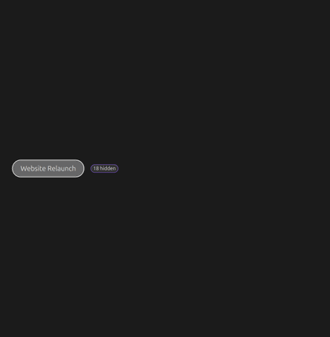
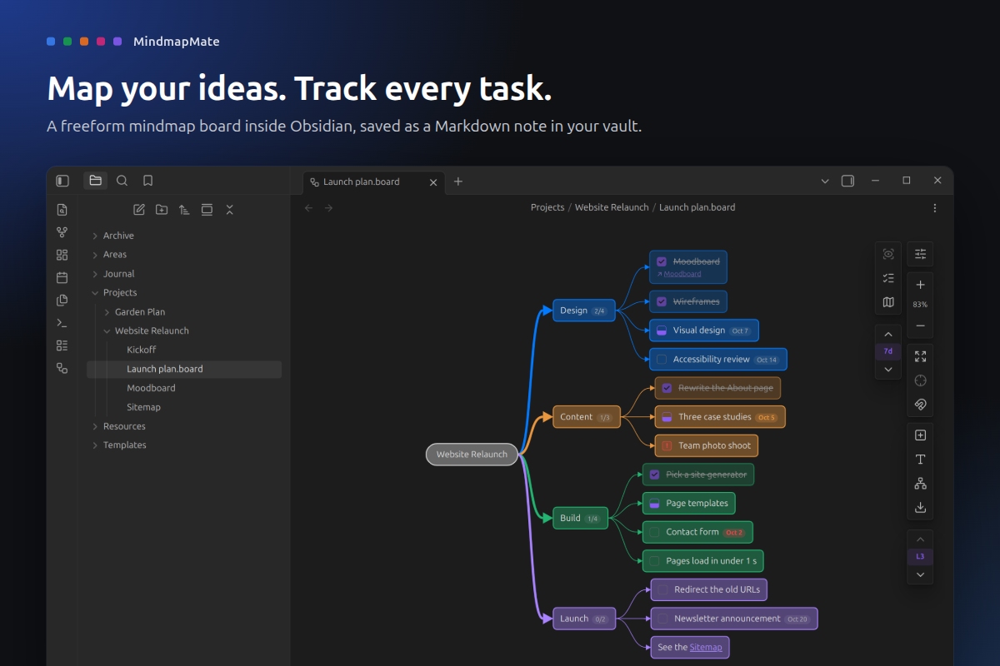
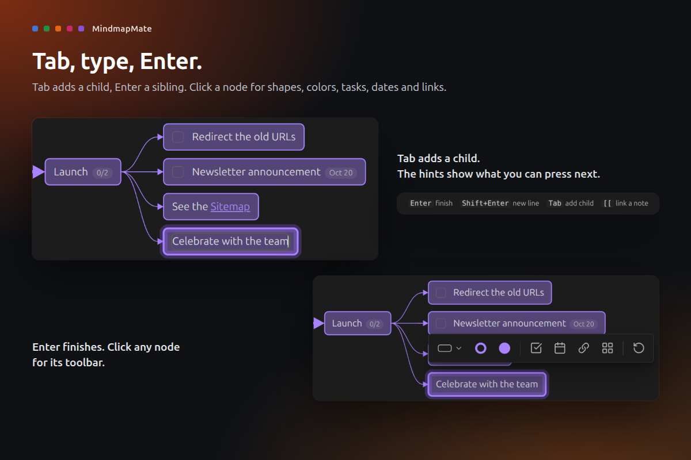
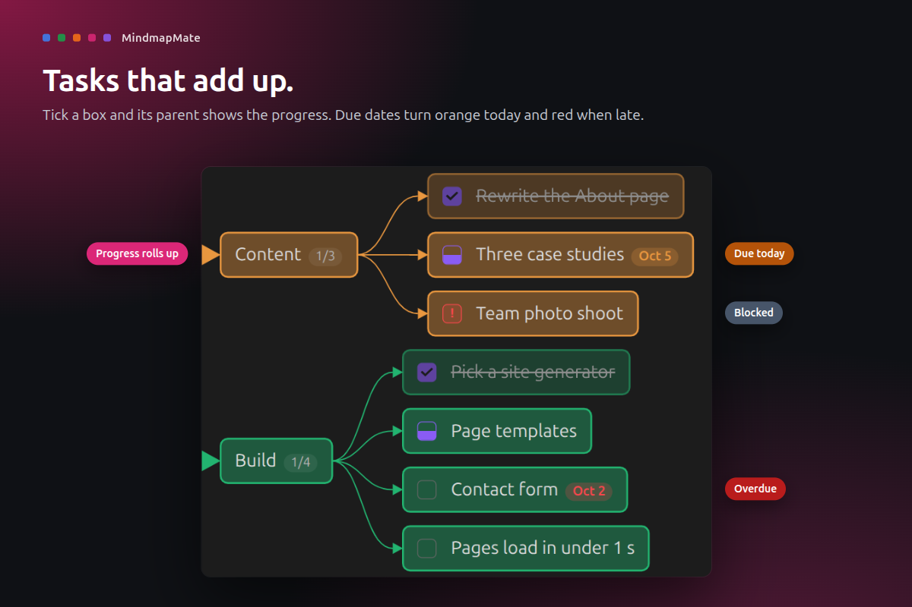
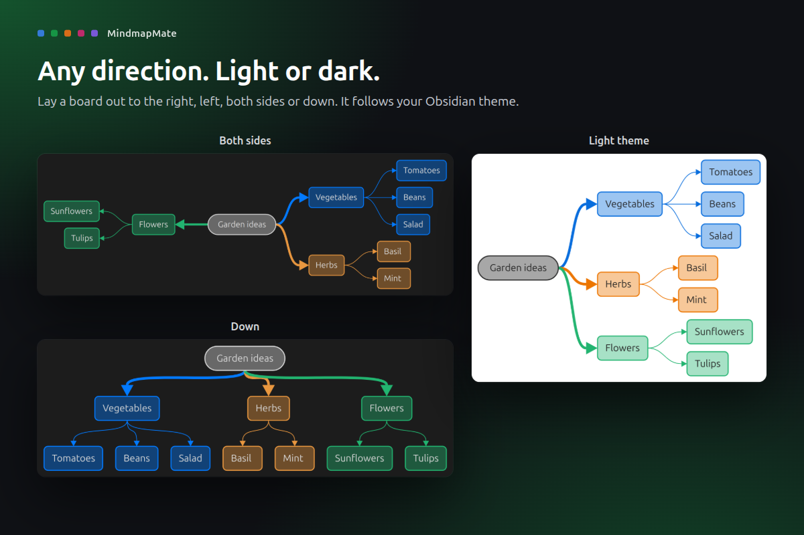
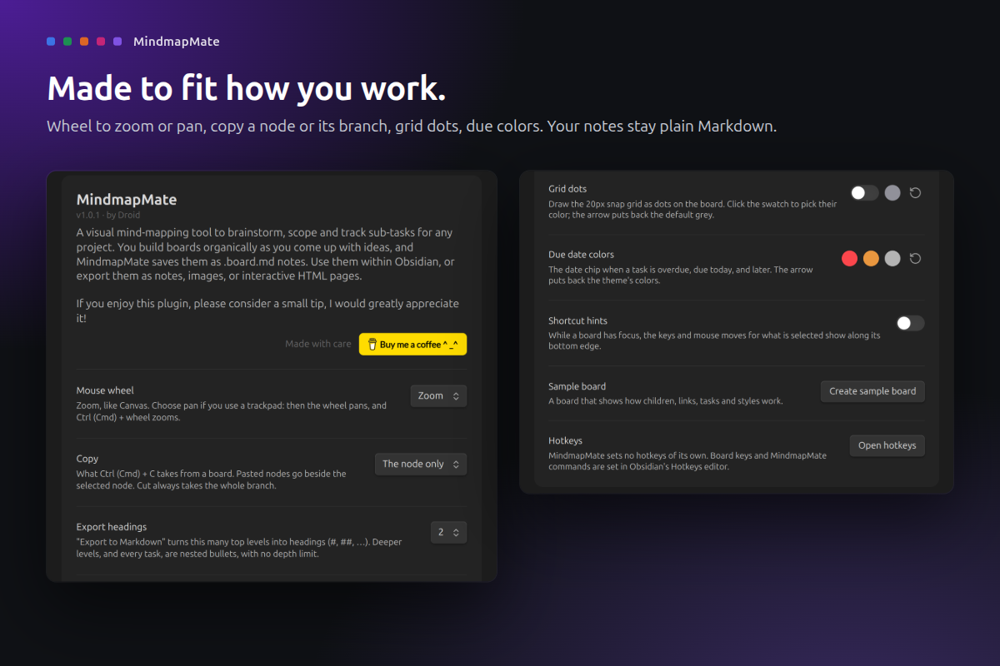

# MindmapMate

**Map your ideas. Track every task.**

Canvas gives you space to think but knows nothing about progress, and a task list has structure but no room to sketch. MindmapMate is both: a freeform mindmap board where every branch can be a task list that counts itself up. Tab, type, Enter, done.

## What it does

- **Think at typing speed.** Tab adds a child, Enter a sibling. Lines, colors and layout take care of themselves.
- **Tasks that add up.** Any node can be a task: not done, doing, blocked, done or dropped. Parents show their progress, like 2/4.
- **Due dates that nudge.** Pick a date from the calendar. Chips turn orange on the day and red when late, and a filter shows what is due soon.
- **Linked to your notes.** Type `[[` to link a note, hover to preview it, or turn a node into a new note. Renames and moves keep links working.
- **Tidy in one click.** Lay a board out to the right, left, both sides or down. Fold branches, focus on one, or jump to a level.
- **Share it anywhere.** Export a Markdown checklist, a PNG or SVG image, or a single HTML page anyone can open in a browser.
- **It is just a note.** Each board is a `.board.md` file in your vault, with a readable outline that search and backlinks can see.

## How to use

1. Install MindmapMate from **Settings > Community plugins** and enable it. A sample board opens and shows you around.
2. Make a board from the ribbon button, a folder's right-click menu, or the command **MindmapMate: New board**.
3. Double-click empty space for a node, type, then press **Tab** for a child or **Enter** for a sibling.
4. Click a node for its toolbar: shape, colors, checkbox, due date and note link.

Every action is also a command. MindmapMate sets no hotkeys of its own; give any command a key in **Settings > Hotkeys**. The [full guide](docs/guide.md) lists every key and feature.

## Privacy and safety

- **Your notes stay yours.** Boards are plain Markdown files in your vault. MindmapMate only writes boards, files you ask for (exports, promoted notes, the sample board), and link updates inside boards.
- **No network, no telemetry.** Nothing is loaded or sent. Exported HTML pages load nothing either.
- **Safe with bad files.** A board it can't read shows an error and is never saved over.
- **Desktop only.** Needs Obsidian 1.13 or later.
- **Signed releases.** Every release is built by GitHub Actions from this repository and carries a [build provenance attestation](https://docs.github.com/en/actions/security-for-github-actions/using-artifact-attestations).

## Support

If MindmapMate helps you plan a little clearer, you can [buy me a coffee](https://buymeacoffee.com/droidstreamer). Thank you!

## Develop

`npm ci`, `npm test`, `npm run lint`, `npm run build` (installs into `../test-vault`), `npm run obsidian:check` (live checks in a real Obsidian), `npm run showcase` (store screenshots), `npm run ship`.

MIT licensed. Made by Droid.
